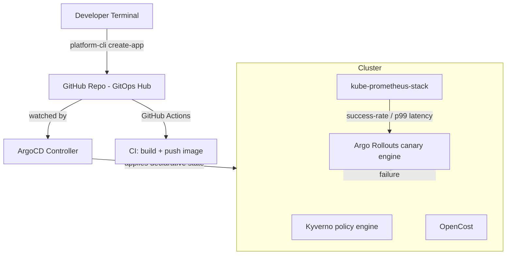

# GitOps Developer Platform

Extends the Adcash interview observability challenge into a full GitOps-driven internal developer
platform: Terraform-provisioned cluster and add-ons, ArgoCD for declarative
state, Argo Rollouts for metric-gated canary deployments, Kyverno for
policy-as-code, and OpenCost for per-namespace cost visibility — plus a
self-service CLI so a developer never hand-writes a Rollout spec.

## Architecture



## Repository layout

```
.
├── cli/                     # Self-service scaffolding CLI (platform-cli)
├── terraform/              # Cluster + platform add-ons (ArgoCD, Rollouts, Kyverno, Prometheus, OpenCost)
├── gitops/                 # App-of-Apps root, tenant Applications, Kyverno policies
├── apps/order-service/     # Rollout, AnalysisTemplate, and Helm chart wrapping both
├── observability/          # Dashboards-as-code, alert rules
├── policy/kubernetes/      # OPA/Rego workload security policies + unit tests
├── .github/workflows/      # Shift-left security pipeline (security.yml)
└── scripts/                # Canary failure simulation, pinned scanner installer
```

## Why an AnalysisTemplate, not just a Deployment

A plain `Deployment` rollout has no idea whether the new version is
actually healthy; it just replaces pods. The `AnalysisTemplate`
(`apps/order-service/analysis-template.yaml`) queries Prometheus every 30s
during the canary window and checks two SLIs against the same request
metrics the observability stack already collects:

| Metric | Gate | Failure limit |
|---|---|---|
| Success rate | ≥ 99.5% | 3 consecutive misses -> abort + rollback |
| p99 latency | ≤ 300ms | 3 consecutive misses -> abort + rollback |

Traffic shifts 10% -> 50% -> 100%, pausing 2m and 5m respectively so the
analysis has real data to evaluate at each step before committing more
traffic to the new version.

**Gotcha worth knowing (and mentioning in an interview):** the Helm chart
version of the AnalysisTemplate has to escape Argo's own `{{ args.* }}`
templating so Helm doesn't try to resolve it first — see the
`{{ "{{" }} ... {{ "}}" }}` trick in
`apps/order-service/helm/templates/analysis.yaml`. Two templating
engines touching the same file is a real thing you hit doing GitOps at
scale, not a contrived example.

## Governance and cost

- **Kyverno** (`gitops/system-addons/kyverno-policies.yaml`) enforces
  resource requests/limits on every pod and blocks `:latest` image tags —
  cluster-wide, before anything reaches ArgoCD's sync.
- **OpenCost** attributes spend per namespace so the `staging` tenant's
  actual compute cost is visible, not just its resource quota.

## Shift-left security pipeline

`.github/workflows/security.yml` runs on every pull request, every push to
`main` and weekly (new CVEs appear in code that has not changed). Any HIGH or
CRITICAL finding, leaked secret or policy violation fails the build, so
nothing insecure reaches the branch ArgoCD syncs from. Findings are uploaded
as SARIF to the repository's Code scanning tab.

| Job | Tooling | What it catches |
|---|---|---|
| `secrets` | gitleaks (full history) | Credentials committed at any point, not just in the latest commit |
| `sast` | Semgrep (Python, secrets, GitHub Actions rules), pytest | Insecure code in the CLI; regression tests for its input validation |
| `deps` | Trivy, pip-audit, CycloneDX SBOM | Vulnerable dependencies; an SBOM artifact on every run |
| `iac` | Checkov, Trivy config | Terraform, Kubernetes, Helm and workflow misconfigurations |
| `policy` | OPA / Conftest | Pod hardening on every workload kind, Argo Rollouts included |

### Why custom OPA policies

Generic scanners only recognise built-in workload kinds. Scanning the
original `order-service` manifest, Trivy reported **7** findings when its
`kind` was `Deployment` and **0** when it was `Rollout`, with an identical pod
spec; Checkov inspected only the Service. Every workload on this platform is
a Rollout, so the default tooling was effectively blind to it.

`policy/kubernetes/workload_security.rego` resolves the pod template for
Pods, Deployments, StatefulSets, DaemonSets, Jobs, CronJobs and Rollouts and
denies: unpinned or `:latest` images, privileged containers, privilege
escalation, running as root, retained Linux capabilities, writable root
filesystems, host namespaces, `hostPath` volumes and missing resource
requests or limits. The Helm chart is rendered with `helm template` and
checked too. `conftest verify` runs the policy unit tests first, which
caught a classic Rego pitfall during development: a bare `not` over a missing
field is undefined, so the rule silently passes. Lookups now use
`object.get` with explicit defaults.

Kyverno still enforces at admission time; the OPA checks shift the same
class of failure left to the pull request, before ArgoCD ever sees it.

### What the pipeline found and fixed

| Finding | Fix |
|---|---|
| `platform-cli --name ../../../x` wrote files outside `gitops/apps/` (path traversal) | DNS-1123 validation plus a resolved-path check that also blocks symlink escapes |
| A newline in `--name` or `--image` injected YAML, e.g. retargeting the generated ArgoCD Application to `kube-system` | Strict `fullmatch` validation (Python's `$` also matches before a trailing newline); platform namespaces are refused |
| `jinja2==3.1.4` had known sandbox-escape advisories | Upgraded to 3.1.6 |
| Rollouts ran as root with a writable root filesystem and default capabilities | Non-root UID, `readOnlyRootFilesystem`, `drop: [ALL]`, no privilege escalation, `RuntimeDefault` seccomp, service account token not mounted, `emptyDir` for `/tmp`; Helm exposes these as values |
| Terraform state files were committed to Git | Untracked and ignored; state belongs in a remote backend |

### Supply chain

- Every GitHub Action is pinned to a full commit SHA, and workflow
  permissions default to `contents: read`.
- `scripts/install-scanners.sh` downloads pinned scanner releases and verifies
  hard-coded SHA-256 hashes, so a tampered release asset fails the build.
- Dependabot keeps the action SHAs, Python packages and Terraform providers
  current.
- A CycloneDX SBOM is published as a build artifact on every run.

Run the same checks locally:

```bash
scripts/install-scanners.sh .bin
.bin/gitleaks git . --redact
.bin/conftest verify --policy policy/kubernetes
.bin/conftest test --policy policy/kubernetes apps/order-service/rollout.yaml
.bin/trivy config .
pip install -r cli/requirements.txt -r cli/requirements-dev.txt && pytest -q cli
```

## Running it locally

```bash
# 1. Local cluster
kind create cluster --name adcash-idp

# 2. Provision platform add-ons
cd terraform
terraform init
terraform apply

# 3. Bootstrap GitOps (ArgoCD reconciles everything else from here)
kubectl apply -f ../gitops/bootstrap/app-of-apps.yaml

# 4. Scaffold a new service without touching YAML by hand
cd ../cli
pip install -r requirements.txt
python3 main.py create-app --name payments-service --image ghcr.io/anirudhbabu/payments-service:v1.0.0
```

## Proving the canary actually works (the demo that matters)

```bash
./scripts/simulate_canary_failure.sh --watch
```

This ships a build that returns HTTP 500 on ~10% of requests. Expected
sequence:
1. Rollout shifts 10% of traffic to the new pods
2. AnalysisTemplate starts failing the success-rate check every 30s
3. After 3 consecutive failures, Argo Rollouts **automatically aborts and
   rolls back** — no human paged, no manual `kubectl rollout undo`

## Portfolio capture checklist

- [ ] ArgoCD UI: App-of-Apps tree showing `adcash-idp-root` -> `order-service`
- [ ] `kubectl argo rollouts get rollout order-service -n staging` mid-abort,
      showing the degraded canary and automatic rollback
- [ ] Grafana `idp-canary-cost` dashboard: success rate dipping below the
      99.5% gate at the same moment the rollout aborts
- [ ] OpenCost namespace cost panel
- [ ] A GIF of `platform-cli create-app` running end-to-end, followed by
      ArgoCD picking up the new Application automatically

## What this demonstrates

- GitOps as the single source of cluster truth (ArgoCD, App-of-Apps pattern)
- Metric-gated progressive delivery instead of blind rolling updates
  (Argo Rollouts + Prometheus AnalysisTemplate)
- Policy-as-code guardrails enforced at admission time (Kyverno) and shifted
  left into CI with OPA/Conftest, covering CRDs generic scanners skip
- A DevSecOps pipeline: secret scanning, SAST, dependency scanning with an
  SBOM, IaC misconfiguration scanning and SHA-pinned supply chain controls
- Cost as a first-class platform signal, not an after-the-fact spreadsheet
  (OpenCost)
- Reducing developer cognitive load with a self-service CLI instead of
  requiring raw manifest authorship — the actual point of an "internal
  developer platform"
